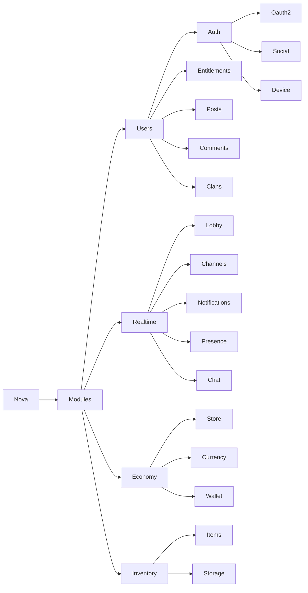
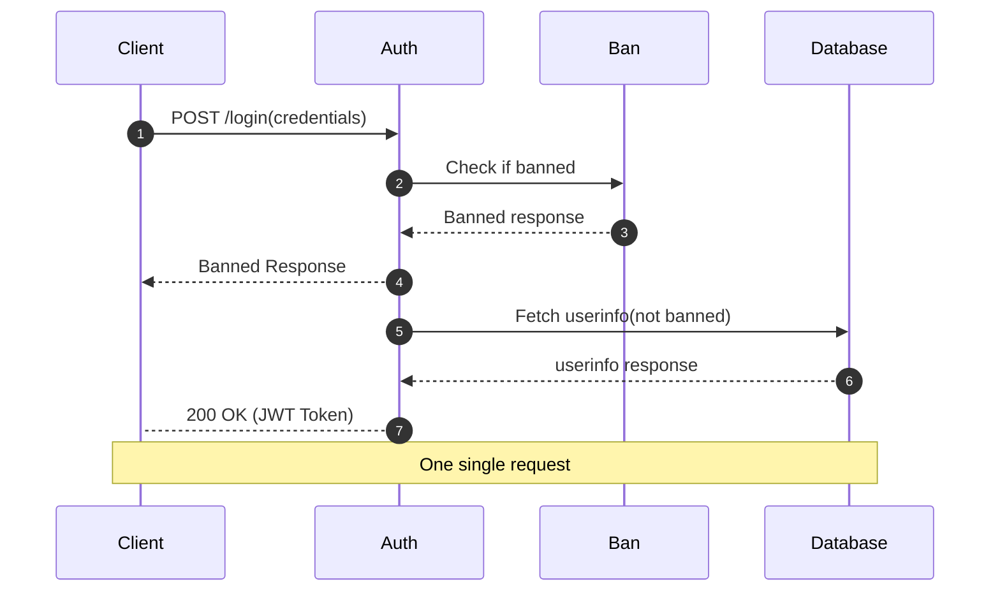
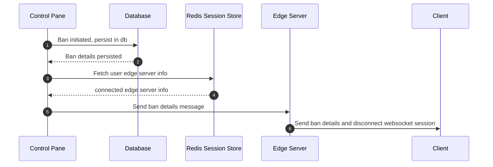
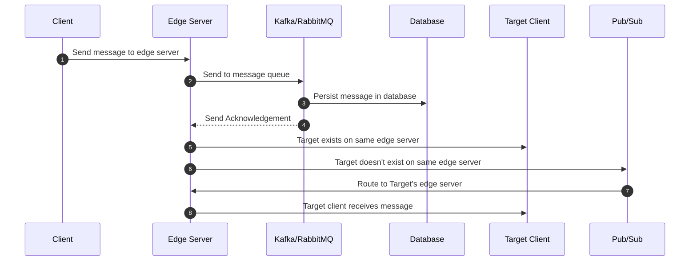
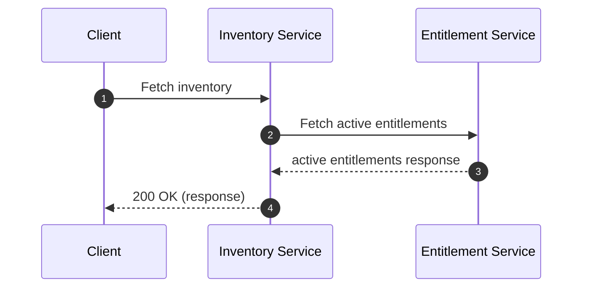
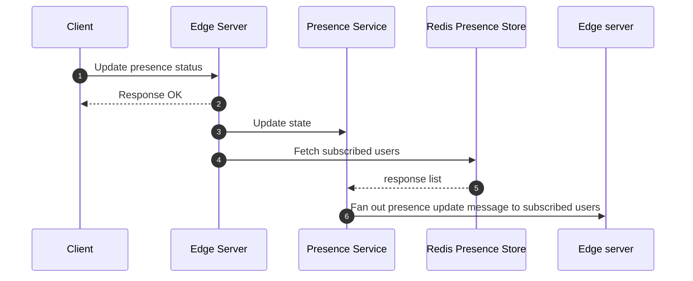

#Nova
A multiplayer backend solution designed from the ground up.
Features -
* Users
* Authentication
  * OAuth 2.0
  * Social Provider
  * Device ID
* Posts
* Comments
* Clans
* Realtime
  * Lobby
  * Chat
  * Channels
  * Notifications
  * Presence
  
**Stack**
* Golang
* Gin
* Postgres
* Redis
* Websocket

**User login flow**

**User ban flow**

**Realtime Message Routing Flow**

**Inventory creation flow**

**Presence update flow**

